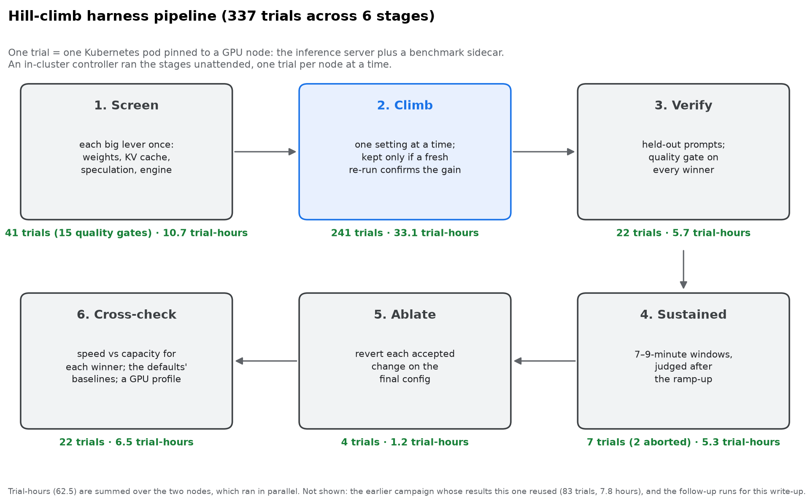

# a100-inference-hillclimb

An automated Kubernetes coordinate-ascent hill-climbing harness for LLM inference engines (**vLLM** and **SGLang**), with pod-per-trial GPU isolation, 3σ run-to-run noise calibration, paired confirmation re-runs, 7–9 minute steady-state capacity searches, and automated quality gates (GSM8K, long-context passkey retrieval, and teacher-forced logprob NLL against BF16).

> **Benchmark Results & Winning Configs (`Nanbeige4.3-33B` on 1× NVIDIA A100 80GB PCIe):**
> If you are looking for the 337-trial benchmark study, all 10 charts, what worked vs. what regressed, and copy-paste `vLLM` / `SGLang` serving commands, see **[`RESULTS.md`](RESULTS.md)** (or query the 432-trial SQLite database directly in [`results/ledger.sqlite`](results/ledger.sqlite)).



---

## How the Harness Works

1. **Pod-per-trial GPU isolation (`harness/runner.py`):**
   - Each trial runs as an isolated Kubernetes pod pinned to a dedicated GPU node ("lane", e.g. `n0` or `n1`), pairing the inference server container (`vLLM` or `SGLang`) with a benchmark sidecar over `localhost`.
   - The pod automatically sizes `/dev/shm` (32 GiB base plus any configured CPU KV offload region), captures startup and tail server logs, samples GPU power/clock/utilization (`nvidia-smi`) and per-process CPU usage, and writes structured trial metrics into [`results/ledger.sqlite`](results/ledger.sqlite).
2. **Versioned workload plans (`harness/plans.py`) and sidecar drivers:**
   - **Single-user decode (`t1n`, `t1v`):** `vllm bench serve` at concurrency 1 on disjoint SPEC-Bench prompt slices with natural stopping (`--Temperature 0.6 --top-p 0.95`, thinking on) plus an 8k-token prefill TTFT guard.
   - **Poisson capacity searches (`t2s`, `t2c`, `t2ss@r`, `t2css@r`):** Geometric rate ladder followed by bisection to find the highest Poisson arrival rate where ≥90% of requests meet both **TTFT ≤ 2 s** and **TPOT ≤ 100 ms**. Steady-state plans (`t2ss@r`, `t2css@r`) run 420–540 s steps and score only requests arriving after the initial 2–3 minute ramp-up and at least 1–1.5 minutes before arrivals end.
   - **Multi-turn agentic sessions (`t3`, `harness/t3_driver.py`):** 48 concurrent 6-turn sessions arriving at 0.2 sessions/s with a shared 3,000-token system prompt, a new 1,200-token document per turn, and 15 s think time between turns, scored by p90 TTFT across all 288 turns.
   - **Quality gate (`quality2`, `harness/quality_driver.py`):** 200 GSM8K problems (thinking on), 9 passkeys buried at 8k / 16k / 28k context, and teacher-forced negative log-likelihood (NLL) + top-1 token agreement over 3,827 greedy BF16 reference tokens.
3. **Noise-calibrated coordinate ascent (`harness/climber.py`):**
   - **Score climbs (`t1n`, `t3`):** A challenger must beat the incumbent by `max(3σ, floor)` on the same node (where `σ` is estimated from all repeated runs of the incumbent) and then repeat that win on a fresh confirmation run on the same node.
   - **Capacity climbs (`t2`, `t2c`):** Each challenger is probed for one step at `1.05×` the incumbent's capacity; if ≥90% of requests meet the SLO and a fresh confirmation run agrees, it runs a full rate search to become the new incumbent.
   - Supports coupled moves (e.g. speculative method × draft length), guided kicks, and leave-one-out ablations (`harness/campaign.py`).

---

## Repository Layout

- **[`RESULTS.md`](RESULTS.md)** — Full benchmark report, 10 charts (`assets/*.png`), ablation table, 3 benchmark bugs fixed, and winning `vLLM` / `SGLang` commands for `Nanbeige4.3-33B` on a single A100 80GB PCIe.
- **`harness/`** — Core Python package:
  - `space.py`: Search space (22 vLLM and 21 SGLang settings across layers L0–L6), validity rules, server flag rendering, canonical config hashing, and quality-gate numerics classes.
  - `plans.py`: Workload definitions and parameterized probe / steady-state rate-search builders.
  - `runner.py`: Kubernetes pod lifecycle, log capture, and GPU/CPU telemetry collection.
  - `bench_driver.py`, `quality_driver.py`, `t3_driver.py`: In-pod benchmark sidecar drivers.
  - `climber.py`, `campaign.py`, `score.py`, `ledger.py`, `cli.py`, `settings.py`: Coordinate-ascent climber, multi-stage campaign runner, scorer, SQLite ledger, and CLI.
- **`campaigns/`** — Declarative campaign JSONs (`main-v3.json`, `followup-v3.json`, `main.json`).
- **`results/ledger.sqlite`** — Complete 432-trial SQLite database from the A100 campaigns.
- **`assets/`** — Charts generated directly from `results/ledger.sqlite` via `tools/post_charts.py`.
- **`deploy/`** — Kubernetes manifest templates (`10-nvme-prep.yaml`, `20-nvidia-device-plugin.tmpl.yaml`, `30-download-models.tmpl.yaml`, `40-controller.tmpl.yaml`, `50-build-w8a8.tmpl.yaml`, `models.lock`).
- **`tools/`** — Operational scripts (`deploy.sh`, `pull.sh`, `stage_sharegpt.sh`, `post_charts.py`, `publish_hf_w8a8.sh`, `render.py`, `check_leaks.py`, `install_hooks.sh`).
- **`tests/`** — Offline simulator and unit tests (`sim_climb.py`, `sim_campaign.py`, `test_bench_driver.py`, `test_env.py`, `test_resolved.py`).
- **`docs/`** — Background research, book review synthesis, and engineering decision logs:
  - [`docs/book-learnings.md`](docs/book-learnings.md): How Philip Kiely's *Inference Engineering* and Chris Fregly's *AI Systems Performance Engineering* shaped the harness v3 design.
  - [`docs/how-providers-measure-llm-speed.md`](docs/how-providers-measure-llm-speed.md): How Artificial Analysis and inference providers measure TTFT, TPOT, and output speed.
  - [`docs/single-vs-two-node-serving.md`](docs/single-vs-two-node-serving.md): Single-node vs. two-node serving over Ethernet.
  - [`docs/a100-inference-engineering-report.md`](docs/a100-inference-engineering-report.md): Initial A100 benchmarking and methodology report.
  - [`docs/decisions.md`](docs/decisions.md): Chronological engineering decision log across all harness revisions.

---

## Quickstart

### 1. Run the offline simulator tests (no GPU cluster or `.env` required)

```bash
python3 -m tests.sim_climb
python3 -m tests.sim_campaign
python3 -m tests.test_bench_driver
python3 -m tests.test_env
python3 -m tests.test_resolved
```

### 2. Inspect `results/ledger.sqlite` or regenerate the charts

```bash
python3 -m harness.cli status --campaign main-v3
python3 -m harness.cli report --campaign main-v3:climb-t1n-vllm
python3 tools/post_charts.py results/ledger.sqlite assets
```

### 3. Deploy on your own Kubernetes GPU cluster

Environment-specific identifiers (kube context, node names, container registry, subscription) live only in a gitignored `.env` and are blocked from commits by `tools/check_leaks.py`:

```bash
cp .env.example .env          # fill in your cluster context, lane nodes, and registry
tools/install_hooks.sh        # install pre-commit and pre-push leak-check hooks
tools/deploy.sh main-v3       # build controller image and launch campaign
```

You can also run individual trials or climbs from the CLI:

```bash
python3 -m harness.cli run --engine vllm --set variant=int4 --plan t1n --lane n0
python3 -m harness.cli batch --file configs.json --plan t2s --campaign screen-1
python3 -m harness.cli climb --track t2 --start start.json --campaign climb-t2
```
