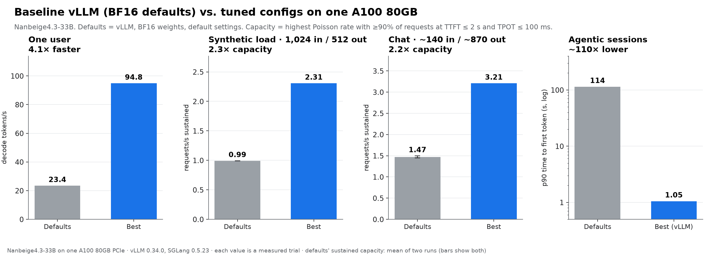
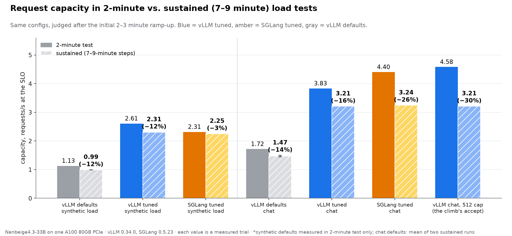
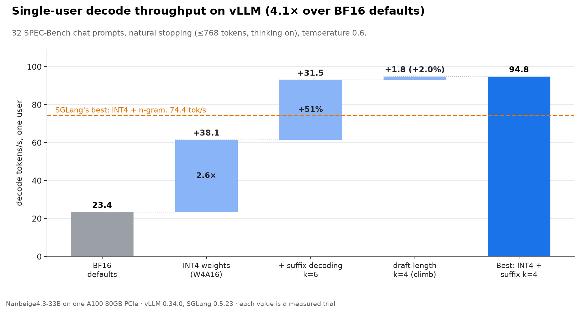
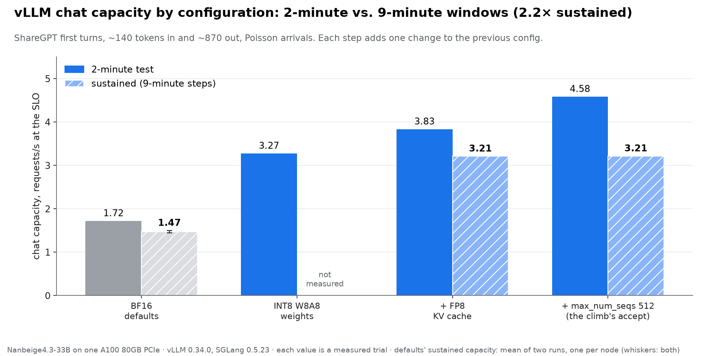
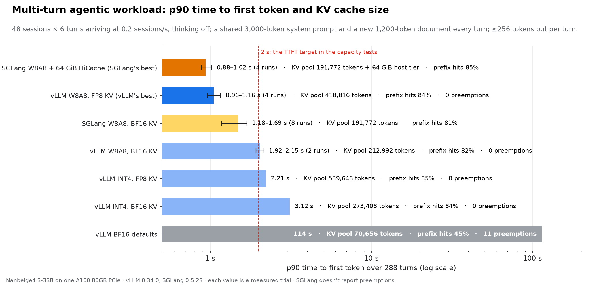
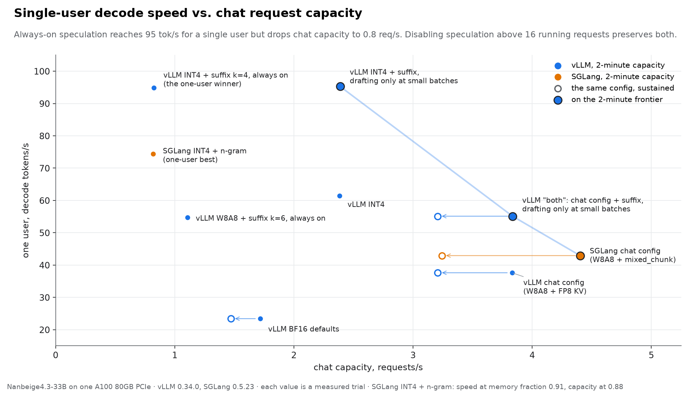
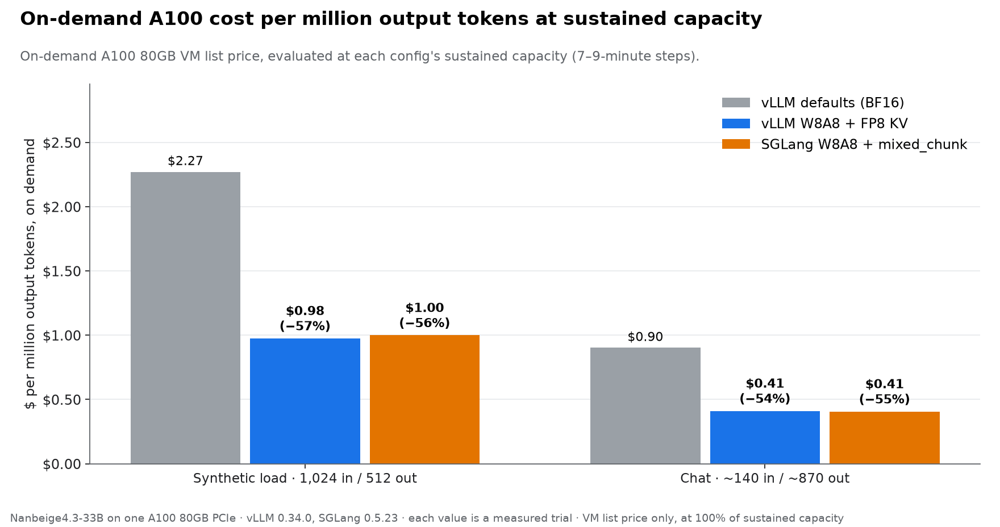
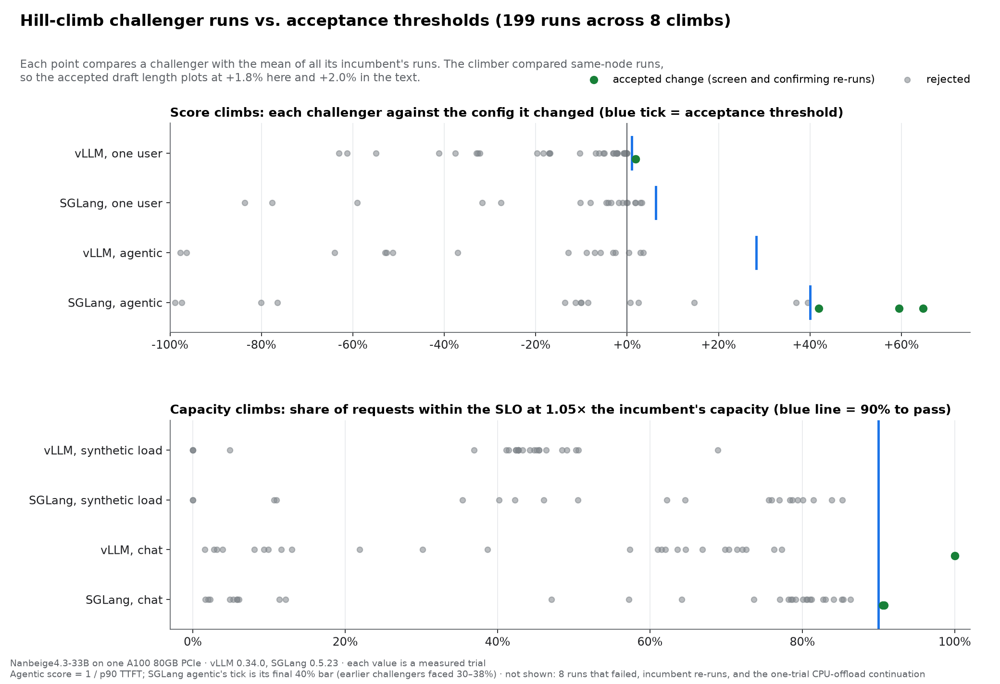
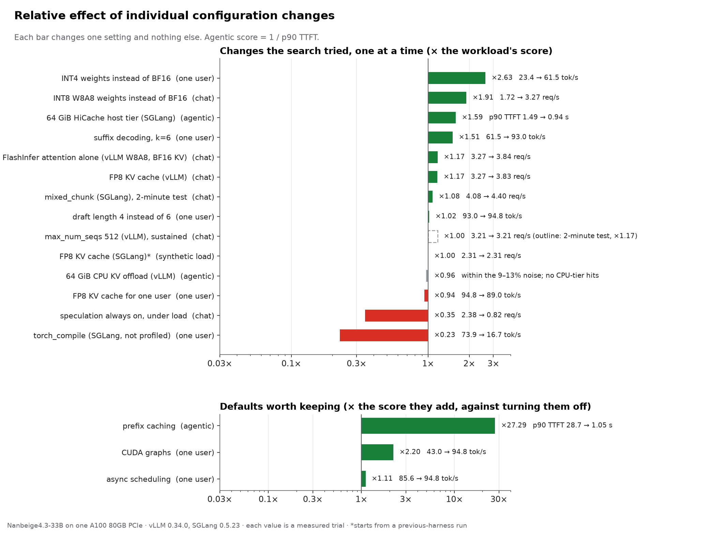

# Benchmark Results: Hill-Climbing `vLLM` and `SGLang` on a Single A100 (`Nanbeige4.3-33B`)



**TL;DR** (`Nanbeige4.3-33B`, vLLM 0.34.0 and SGLang 0.5.23 on 1× NVIDIA A100 80GB PCIe across four synthetic workloads)

- **Single-user decode speed:** Improved from **23.4 tokens/sec to 94.8 tokens/sec (4.1×)** on vLLM over BF16 defaults using INT4 weights and suffix speculative decoding (`k=4`), and **74.4 tokens/sec (3.1×)** on SGLang using INT4 and n-gram speculation (`k=4`).
- **Batched chat throughput (9-minute sustained):** Increased from **1.45–1.50 requests/sec to 3.21 requests/sec (2.2×)** on vLLM (`INT8 W8A8 + FP8 KV`) and **3.24 requests/sec** on SGLang (`INT8 W8A8 + mixed_chunk`) under a latency target of TTFT ≤ 2 seconds and TPOT ≤ 100 ms.
- **Multi-turn agentic latency (p90 time to first token):** Dropped from **114 seconds to 1.05 seconds** on vLLM (`INT8 W8A8 + FP8 KV`) and **0.94 seconds** on SGLang (`INT8 W8A8 + 64 GiB host-DRAM HiCache`) once active session context fit in the KV pool.
- **Three deployment choices drove almost all of the gain:** weight quantization, KV cache precision/tiering, and speculative decoding. Across 241 subsequent hill-climb trials over 43 engine flags, only four single-knob changes cleared the noise bar. vLLM's one chat scheduler change (`max_num_seqs` 256 → 512) gained +19% in 2-minute tests (**3.84 to 4.58 requests/sec**) but +0.1% over 9 minutes (**3.21 requests/sec**).
- **Quality and cost per 1M output tokens:** Every winning configuration scored 97.0–98.5% on GSM8K (BF16: 97.5–98.0%) and 9/9 on long-context passkeys. On an on-demand A100, sustained chat cost dropped from **\$0.90 per 1M output tokens down to \$0.41 per 1M output tokens** on both engines.

---

## Why I Ran This

Over the past few months I read the entirety of Philip Kiely's [*Inference Engineering*](https://www.baseten.co/inference-engineering/) ([Amazon](https://www.amazon.in/Inference-Engineering-Colour-Indian-Reprint/dp/9368089825)) and Chris Fregly's [*AI Systems Performance Engineering*](https://www.amazon.com/Systems-Performance-Engineering-Optimizing-Inference/dp/B0F47689K8) (awesome books btw), and went back and forth on [Artificial Analysis's benchmarking methodologies](https://artificialanalysis.ai/methodology). I wanted to understand firsthand what inference engineers go through when automating, tweaking, and productionizing model serving across hardware, traffic shapes, and latency targets.

To experience that myself and test whether my vision for automated production inference infrastructure is possible, I built a hill-climbing benchmark harness and tuned a deployment from scratch.

In many cloud regions and markets, Hopper and Blackwell GPUs are hard to get, while Ampere A100s are what most people may have a chance of reserving. I had quota for single Azure A100 80GB PCIe nodes (`Standard_NC24ads_A100_v4`). I paired the single nodes with **Nanbeige4.3-33B** (a dense 33.1B reasoning model whose ≈62 GiB BF16 weights nearly fill an 80 GB card, from a family gaining traction on [Artificial Analysis's small-model leaderboards](https://artificialanalysis.ai/articles/mobile-phone-intelligence-inference)). I then used GitHub Copilot (with Claude Opus 5.5) to build the harness on Azure Kubernetes Service (AKS) and run 337 automated hill-climb trials over 41 hours across two A100 nodes.

**Scope:** These results apply specifically to `Nanbeige4.3-33B` on a single A100 80GB PCIe across four synthetic `vllm bench serve` workloads. Out of the box, vLLM defaults to BF16 weights, a BF16 KV cache, and no speculative decoding; once those three choices were set per workload, vLLM's internal scheduler and kernel defaults needed almost no changes.

---

## Setup, Baseline, and Summary of Results

- **Hardware & engines:** 1× NVIDIA A100 80GB PCIe per server (`Standard_NC24ads_A100_v4`), running **vLLM 0.34.0** and **SGLang 0.5.23**. Under sustained load, the 300 W PCIe card hit its power cap in 95–98% of busy samples (≈1.2 GHz SM clock vs. 1.41 GHz boost), so a 400 W SXM A100 should run faster.
- **Checkpoints:** Official BF16, FP8, INT8 (W8A16), and INT4 (W4A16) weight-only checkpoints, plus a data-free **INT8 W8A8** checkpoint built with `llm-compressor` ([recipe below](#winning-vllm-and-sglang-configurations)).
- **Capacity definition:** Capacity is the highest Poisson request arrival rate at which at least 90% of requests meet both **TTFT ≤ 2 s** and **TPOT ≤ 100 ms** (≈10 tokens/s per user). The harness steps up the arrival rate until a step fails, bisects, and interpolates the 90% crossing. A **2-minute test** uses 120-second steps; a **sustained test** uses 7–9 minute steps (420 s for synthetic load, 540 s for chat), scored only on requests arriving after the initial 2–3 minute ramp-up and at least 1–1.5 minutes before arrivals stop.

| Workload & traffic shape | vLLM BF16 baseline | Tuned vLLM | Tuned SGLang | Winning configurations |
|---|---|---|---|---|
| **Single user:** 32 SPEC-Bench prompts, `c=1`, thinking on, ≤768 tok | 23.4 tok/s | **94.8 tok/s** (4.1×) | **74.4 tok/s** (3.1×) | vLLM: INT4 + suffix `k=4`<br>SGLang: INT4 + n-gram `k=4` |
| **Synthetic load:** Poisson, 1,024-tok random in, 512-tok out | 0.99 req/s sustained (1.13 in 2-min*) | **2.31 req/s** sustained (2.61 in 2-min, 2.3×) | **2.25 req/s** sustained (2.31 in 2-min) | vLLM: INT8 W8A8 + FP8 KV<br>SGLang: INT8 W8A8 |
| **Chat:** Poisson, ShareGPT (≈140 in / ≈870 out, thinking on, ≤1,024 tok) | 1.45–1.50 req/s sustained (1.72 in 2-min) | **3.21 req/s** sustained (3.83 in 2-min, 2.2×) | **3.24 req/s** sustained (4.40 in 2-min) | vLLM: INT8 W8A8 + FP8 KV<br>SGLang: INT8 W8A8 + `mixed_chunk` |
| **Agentic:** 48 sessions at 0.2/s, 6 turns (3k sys + 1.2k doc/turn, thinking off) | 114 s p90 TTFT | **1.05 s p90** (≈110× lower) | **0.94 s p90** (≈120× lower) | vLLM: INT8 W8A8 + FP8 KV<br>SGLang: INT8 W8A8 + 64 GiB HiCache |

*\*2-minute synthetic baseline from the prior harness revision (same test without `--enable-mfu-metrics`).*

**Why the out-of-the-box BF16 baselines are slow:**
- **vLLM BF16 defaults:** First, every output token reads ≈62 GiB of model weights; across weight formats, single-user step time fits `4.6 ms + bytes / 1.69 TB/s` (87% of peak 1.935 TB/s bandwidth), which caps BF16 near 24 tokens/s. Second, after loading BF16 weights, only **70,656 KV tokens** fit in 80 GB (208 KiB/token). In the multi-turn agentic workload, ≈30 concurrent sessions hold roughly twice that much active context, dropping prefix-cache hits to 44.7% and causing 11 scheduler preemptions.
- **SGLang BF16 defaults:** Left at its automatic setting on this GPU, SGLang resolved `mem_fraction_static` to `0.83`, leaving 9.7 GB of GPU memory unused and only **16,759 BF16 KV tokens**, limiting it to 0.50 chat requests/s in a 2-minute test until `mem_fraction_static` was raised to `0.88–0.91`.

**Why 2-minute load tests overstate sustained capacity:** Near capacity, the active batch takes several minutes to stabilize. At vLLM's 2-minute synthetic capacity rate, running requests averaged 99 during minute 2 but grew to 210 by minute 5, pushing median TPOT from 79 ms (minute-1 arrivals) to 139–150 ms (minute 3–4 arrivals). Across configurations, 7–9 minute sustained capacities were **3–30% lower** than 2-minute capacities.



---

## Breakdown by Workload (`vLLM` and `SGLang`)

### 1. Single user (`23.4 → 94.8 tok/s` on vLLM; `74.4 tok/s` on SGLang)

At concurrency 1, decode latency is bound by how many weight bytes the GPU reads per step and how many tokens it can verify per forward pass.



- **vLLM (`23.4 → 94.8 tok/s`, 4.1×):** Quantizing weights to INT4 (W4A16) cuts per-token weight reads to ≈30% of BF16 (accounting for group scales and the BF16 `lm_head`) while the fixed ≈4.6 ms/token overhead stays constant, reaching **61.5 tok/s** (2.6×). Adding suffix speculative decoding (which matches suffixes of the current generation against the prompt and prior outputs without a draft model) raises throughput to **93.0 tok/s** at `k=6` (+51%). The 47-trial single-user climb accepted one further change, reducing draft length from `k=6` to `k=4` (**94.8 tok/s**, +2.0%, and **95.8–96.3 tok/s** on held-out prompts) because `k=6` added ≈4% step time for only 0.026 extra accepted tokens per step.
- **SGLang (`74.4 tok/s` best):** In the single-user screen, SGLang started from INT4 without speculation at **62.1 tok/s** (matching vLLM's 61.5 tok/s; BF16 + n-gram `k=4` ran at **30.6 tok/s**). Adding n-gram speculative decoding (`k=4`) to INT4 raised SGLang to **74.4 tok/s** across four runs (3.2× over vLLM's 23.4 tok/s BF16 baseline), and its 23-trial climb accepted no further changes. vLLM's 28% single-user lead came from suffix decoding, which SGLang's search space did not include; on single-user W8A8 without speculation, SGLang was 13% faster than vLLM (`43.0 vs. 38.0 tok/s`).

### 2. Batched load (`3.21 req/s` vLLM vs. `3.24 req/s` SGLang sustained chat)

On Hugging Face, Nanbeige released official `BF16`, `FP8`, `INT8 (W8A16)`, and `INT4 (W4A16)` checkpoints. On an A100 (Ampere), all three quantized checkpoints run as **weight-only (`WxA16`)**: A100 has no FP8 tensor cores (those started on H100, so FP8 runs weight-only at **1.23 requests/sec** on synthetic load vs. BF16's **1.13 requests/sec**), and `INT4 (W4A16)` / `INT8 (W8A16)` quantize only the weights to save HBM bandwidth while keeping activations in BF16 (`A16`). Inside every matrix multiply, the GPU unpacks the weights back to BF16 and runs the math on **BF16 tensor cores** (312 TFLOPS peak). Under concurrent batched load or long 8k prefills, the server becomes compute-bound, and unpacking INT4 weights makes an 8k-token prefill slower than plain BF16 (**3.47 seconds** under INT4 vs. **2.74 seconds** under BF16), leaving INT4 27–39% behind under load.

The A100 *does* have **INT8 tensor cores** (**624 TOPS peak, 2× its BF16 tensor core speed**), but using them requires **both weights (`W8`) and activations (`A8`)** to be INT8. Since no official `W8A8` checkpoint existed, I used `vllm-project/llm-compressor` to build a custom **INT8 W8A8** checkpoint (per-channel INT8 weights + dynamic per-token INT8 activations), which gave both half the weight memory (+28 GiB for KV cache) and INT8 tensor-core compute, cutting 8k prefill time from **2.74 seconds to 1.68 seconds**.



- **vLLM (`1.47 → 3.21 req/s` sustained chat, 2.2×; `0.99 → 2.31 req/s` sustained synthetic, 2.3×):** Switching from BF16 to INT8 W8A8 raised 2-minute chat capacity from `1.72` to `3.27 req/s` (+91%). Adding `--kv-cache-dtype fp8` raised 2-minute chat capacity to `3.83 req/s` (+17%) and synthetic capacity from `1.98` to `2.61 req/s` (+32%). On A100, enabling FP8 KV in vLLM also switches the attention backend from FlashAttention-2 to FlashInfer: a control run of W8A8 + BF16 KV with `--attention-backend FLASHINFER` reached **3.84 chat req/s**, showing that FlashInfer drove the short-prompt chat gain while FP8 KV's 2× larger pool drove the multi-turn agentic gain below. In the 34-trial chat climb, vLLM raised `max_num_seqs` from 256 to 512 (`3.84 → 4.58 req/s` in 2-minute tests, +19%), but over 9-minute windows both caps sustained **3.21 req/s** (at 256 requests wait in the queue; at 512 the larger active batch exceeds 100 ms TPOT).
- **SGLang (`3.24 req/s` sustained chat; `2.25 req/s` sustained synthetic):** With INT8 W8A8 at `mem_fraction_static=0.91`, SGLang reached `4.19 req/s` in 2-minute chat tests, and its 38-trial climb accepted `--enable-mixed-chunk` (`4.40 req/s` in 2-minute tests, **3.24 req/s** sustained). Unlike vLLM, enabling an FP8 KV cache in SGLang changed synthetic capacity by **+0.0%** (`2.31 → 2.31 req/s`): doubling the KV pool eliminated request queueing, but the larger running batch pushed decode TPOT past 100 ms. On a mixed-length workload with 15% 8,192-token prompts (3-minute steps), SGLang carried **1.74×** vLLM's request rate, aided by its larger default prefill chunk (`8,192` vs. vLLM's `2,048`).

### 3. Multi-turn agentic sessions (`114 s → 1.05 s` vLLM; `0.94 s` SGLang p90 TTFT)

In the 6-turn agentic benchmark, every turn re-sends the session's full history plus a new 1,200-token document, so latency depends on keeping all active sessions in the prefix cache without eviction.



- **vLLM (`114 s → 1.05 s` mean p90 TTFT):** Combining W8A8 weights with an FP8 KV cache expands vLLM's GPU KV pool 5.9× (`70,656 → 418,816 tokens`), raising prefix-cache hits from 44.7% to 84.5% (the repeating share of the prompts), eliminating all 11 preemptions, and dropping p90 TTFT to **0.96–1.16 s** across four runs. With W8A8 and a BF16 KV cache (`212,992 tokens`), vLLM already reached 82% hits and 0 preemptions, yet overall p90 TTFT stayed near ≈2.0 s because late-turn evictions pushed turn-5 p90 to 2.2–2.9 s. Doubling the pool with FP8 KV kept every turn near 1.0 s. Testing vLLM's 64 GiB CPU KV offload (`--kv-offloading-size 64`) recorded zero CPU-tier hits on this workload.
- **SGLang (`88.9 s → 1.49 s → 0.94 s` mean p90 TTFT):** W8A8 weights expanded SGLang's GPU KV pool to `191,772 tokens` and reduced p90 TTFT to `1.49 s` (81.6% prefix hits). In the 26-trial SGLang agentic climb, adding a **64 GiB host-DRAM HiCache (`write_through`)** raised prefix hits to 84.9% and cut p90 TTFT to **0.88–1.02 s** (**0.94 s** mean).

### 4. Serving both single-user and batched traffic

Leaving speculative decoding on at all batch sizes reduces INT4's 2-minute chat capacity by 65% (`2.38 → 0.82 req/s`), because verifying draft tokens adds compute per step and pushes TPOT past 100 ms above 22 concurrent requests. Conversely, the batched chat winners without speculation decode at 37.6 tok/s (vLLM) and 43.0 tok/s (SGLang) for a single user.



Setting vLLM's `num_speculative_tokens_per_batch_size` to draft 4 tokens at batch sizes 1–4, 2 tokens at batch sizes 5–16, and 0 above 16 preserves both regimes:
- **vLLM INT4 + batch-scheduled suffix decoding:** Reaches **95.3 tok/s** for a single user and **2.39 req/s** in 2-minute chat tests (vs. 2.38 without speculation).
- **vLLM W8A8 + FP8 KV + batch-scheduled suffix decoding:** Reaches **55.1 tok/s** for a single user (+47% over 37.6 tok/s), **3.84 req/s** in 2-minute chat tests, and **3.21 req/s** sustained over 9 minutes (matching the 3.21 req/s sustained chat config without speculation).

### 5. Quality verification and cost per 1M output tokens



- **Quality gate (vLLM and SGLang):** To verify that quantizing weights (INT4, INT8 W8A8) and KV cache (FP8) did not degrade model accuracy or long-context recall, every winning configuration had to pass three automated checks against same-engine BF16:
  1. **Math reasoning ([GSM8K](https://huggingface.co/datasets/openai/gsm8k), 200 questions with thinking on):** All winners scored **97.0–98.5%**, matching the unquantized BF16 baseline (**97.5%** on vLLM, **98.0%** on SGLang; standard error ±1.1%).
  2. **Long-context needle-in-a-haystack (passkey retrieval at 8k, 16k, and 28k tokens):** Tested whether FP8 KV caching hurt long-context attention by hiding a random passkey in up to 28k tokens of text; all winners retrieved **9 out of 9** passkeys.
  3. **Token-by-token agreement with BF16:** Across 32 greedy BF16 responses (3,827 tokens), INT4 and INT8 W8A8 (with BF16 or FP8 KV) predicted the exact same top-1 next token as BF16 **94–95% of the time** (compared to **99.1%** when re-running BF16 against itself; per-token negative log-likelihood rose by 0.03–0.04 nats, or ≈4% perplexity).
- **On-demand cost per 1M output tokens:**
  - **Sustained chat:** Both tuned engines cost **\$0.41 / 1M output tokens**, down from **\$0.90 / 1M** on the vLLM BF16 baseline (operating at 85% capacity for latency headroom adds 18%).
  - **Sustained synthetic load (1,024 in / 512 out):** **\$0.98 / 1M** on tuned vLLM and **\$1.00 / 1M** on tuned SGLang, down from **\$2.27 / 1M** on the sustained BF16 baseline (**\$1.99 / 1M** in 2-minute tests). Single-user serving (89–95 tok/s end to end) costs **\$12.2–\$12.9 / 1M**.

---

## Coordinate-Ascent Search Across 43 Flags



Across 199 challenger evaluations in the 8 coordinate-ascent climbs (22 vLLM flags and 21 SGLang flags), only four single-setting changes cleared confirmation (`spec_k` 6 → 4 on vLLM single user, `max_num_seqs` 256 → 512 on vLLM chat, `mixed_chunk` on SGLang chat, and 64 GiB HiCache on SGLang agentic).

---

## What Didn't Work and Measurement Bugs Fixed

I also found several settings that surprisingly regressed or failed during the search, including options like `torch_compile` and single-user FP8 KV caching that I expected to help:



| Change tried | Engine & workload | Measured effect | Why |
|---|---|---|---|
| **Speculation always on** | vLLM, chat | −65% capacity (`2.38 → 0.82 req/s`) | Verifying drafts adds compute/step; TPOT exceeds 100 ms above 22 requests |
| **FP8 KV cache at batch 1** | vLLM, single user | −6.2% decode (`94.8 → 89.0 tok/s`) | KV reads are ≈1% of bandwidth at short context; switching to FlashInfer cost −1.7% alone |
| **FP8 KV cache under load** | SGLang, synthetic load | +0.0% capacity (`2.31 → 2.31 req/s`) | Larger KV pool removed queueing, but the bigger active batch pushed TPOT > 100 ms |
| **`torch_compile`** | SGLang, single user | −77% decode (`73.9 → 16.7 tok/s`) | Unprofiled regression on this model/container |
| **Triton / FlexAttention** | vLLM, single user | −0.6% / −6.2% decode | Also slowed 8k prefill to 4.3 s and 6.8 s (vs. 3.5 s on FlashAttention-2) |
| **64 GiB CPU KV offload** | vLLM, agentic | −3.5% (within noise) | Zero CPU-tier prefix-cache hits recorded on this workload |
| **`mixed_chunk`** | SGLang, synthetic load | 42% SLO pass at 1.05× probe | Helped variable-length ShareGPT chat (+5–8%), hurt uniform 1,024-token prompts |
| **`mem_fraction_static ≥ 0.91`** | SGLang, batched load | OOM at startup (0.94) or under load (0.91 + INT4 n-gram) | `0.88` was stable across all configurations |
| **W4A8 / block-scaled FP8** | vLLM & SGLang | Unsupported on A100 | W4A8 kernels require Hopper (SM90); SGLang could not load block-scaled FP8 on SM80 |

**Three benchmark bugs I found and fixed along the way:**
1. **Forced output lengths vs. natural stopping:** Passing `--ignore-eos` with a fixed 512-token output length inflated suffix decoding from **1.57× to 1.97×**, and synthetic random tokens made `k=4` look 2.2× faster than `k=6` (`148.6 vs. 69.1 tok/s`) instead of +2.0%.
2. **2-minute windows and drain-time goodput:** 120-second steps end before queues stabilize, and `vllm bench serve`'s built-in goodput divides by total wall time including post-arrival drain. Scoring only steady-window arrivals and counting failed requests as misses fixed both biases.
3. **Pod `/dev/shm` limits and `--seed`:** vLLM's 64 GiB CPU KV offload failed at startup until `/dev/shm` was raised above 32 GiB. Fixing both issues produced two upstream vLLM PRs: [#68859](https://github.com/vllm-project/vllm/pull/68859) (merged, honoring `--seed` for SPEC-Bench) and [#69018](https://github.com/vllm-project/vllm/pull/69018) (in review, documenting `/dev/shm` sizing for CPU KV offload).

---

## Winning `vLLM` and `SGLang` Configurations

> **Scope disclaimer:** These configurations were tuned specifically for `Nanbeige4.3-33B` on a single Azure `Standard_NC24ads_A100_v4` (A100 80GB PCIe) under the four synthetic traffic shapes and latency SLOs defined above. Different models, prompt distributions, output lengths, latency targets, or GPUs will shift the optimal settings. Re-benchmark on your own workload before deploying.

**Single user: vLLM (94.8 tokens/s) and SGLang (74.4 tokens/s):**

```bash
# vLLM (add num_speculative_tokens_per_batch_size below if the server also takes concurrent requests)
vllm serve Nanbeige/Nanbeige4.3-33B-INT4 --max-model-len 32768 \
  --speculative-config '{"method": "suffix", "num_speculative_tokens": 4}'

# SGLang
python3 -m sglang.launch_server --model-path Nanbeige/Nanbeige4.3-33B-INT4 --context-length 32768 \
  --mem-fraction-static 0.88 --speculative-algorithm NGRAM --speculative-num-draft-tokens 4
```

**Batched load: vLLM (2.31 synthetic / 3.21 chat req/s sustained) and SGLang (2.25 synthetic / 3.24 chat req/s sustained):**

```bash
# vLLM (also the vLLM agentic winner at 1.05 s p90 TTFT)
vllm serve <your INT8 W8A8 checkpoint> --max-model-len 32768 --kv-cache-dtype fp8

# SGLang (remove --enable-mixed-chunk for uniform 1k-token synthetic prompts)
python3 -m sglang.launch_server --model-path <your INT8 W8A8 checkpoint> --context-length 32768 \
  --mem-fraction-static 0.91 --enable-mixed-chunk
```

**Combined single-user + batched load: vLLM (55.1 tokens/s single user; 3.84 chat req/s in 2-minute tests; 3.21 req/s sustained):**

```bash
vllm serve <your INT8 W8A8 checkpoint> --max-model-len 32768 --kv-cache-dtype fp8 \
  --speculative-config '{"method": "suffix", "num_speculative_tokens": 4,
    "num_speculative_tokens_per_batch_size": [[1, 4, 4], [5, 16, 2], [17, 4096, 0]]}'
```

**Multi-turn agentic sessions: SGLang (0.94 s p90 TTFT):**

```bash
python3 -m sglang.launch_server --model-path <your INT8 W8A8 checkpoint> --context-length 32768 \
  --mem-fraction-static 0.91 --enable-hierarchical-cache --hicache-size 64 --hicache-write-policy write_through
```

All vLLM runs also passed `--reasoning-parser qwen3 --enable-auto-tool-choice --tool-call-parser qwen3_coder --safetensors-load-strategy prefetch` (and `--enable-mfu-metrics` on load and agentic runs). SGLang runs passed `--reasoning-parser qwen3 --tool-call-parser qwen3_coder --enable-metrics`. All other flags were left at engine defaults (`max_num_seqs=256` and `max_num_batched_tokens=2048` in vLLM).

**Generating the data-free INT8 W8A8 checkpoint** (per-channel INT8 weights, dynamic per-token INT8 activations, BF16 `lm_head`):

```python
from llmcompressor import oneshot
from llmcompressor.modifiers.quantization import QuantizationModifier
from transformers import AutoModelForCausalLM, AutoTokenizer
import torch

model = AutoModelForCausalLM.from_pretrained("Nanbeige/Nanbeige4.3-33B", torch_dtype=torch.bfloat16, device_map="cuda")
oneshot(model=model, recipe=QuantizationModifier(targets="Linear", scheme="W8A8", ignore=["lm_head"]))
model.save_pretrained("Nanbeige4.3-33B-W8A8-INT8", save_compressed=True)
AutoTokenizer.from_pretrained("Nanbeige/Nanbeige4.3-33B").save_pretrained("Nanbeige4.3-33B-W8A8-INT8")
```

Copy `chat_template.jinja`, `generation_config.json`, `tokenizer.model`, and `added_tokens.json` from the BF16 checkpoint if absent so reasoning and chat templates resolve identically.

**Benchmark commands** (`vllm bench serve` over localhost; all runs include `--percentile-metrics ttft,tpot,itl,e2el --metric-percentiles 50,90,99 --goodput ttft:2000 tpot:100 --save-detailed`):

```bash
# Single user: SPEC-Bench shuffled once with seed 0, prompts 0-31 saved to a file
--backend openai-chat --endpoint /v1/chat/completions --dataset-name spec_bench --dataset-path <prompts 0-31> \
  --disable-shuffle --spec-bench-output-len 768 --max-concurrency 1 --num-prompts 32 --temperature 0.6 --top-p 0.95
# Synthetic load: one step of the rate search
--dataset-name random --random-input-len 1024 --random-output-len 512 --random-range-ratio 0 --ignore-eos \
  --request-rate <r> --burstiness 1.0 --max-concurrency 1024
# Chat: one step of the rate search (fixed 30k ShareGPT subset; each step shuffles via --seed)
--backend openai-chat --endpoint /v1/chat/completions --dataset-name sharegpt --dataset-path <the 30k subset> \
  --sharegpt-output-len 1024 --temperature 0.6 --top-p 0.95 --request-rate <r> --burstiness 1.0 --max-concurrency 1024
```

**Climb log (`vLLM` and `SGLang`):**

| Climb | Starting config (2-min / single-run) | Threshold | Trials | Accepted change | Final result |
|---|---|---|---|---|---|
| vLLM, single user | INT4 + suffix `k=6`: 93.0 tok/s | 1.0% (floor) | 47 | `spec_k` 6 → 4 (+2.0%) | 94.8 tok/s |
| SGLang, single user | INT4 + n-gram `k=4`: 73.2–76.2 tok/s | 6.25% | 23 | none | 74.4 tok/s mean |
| vLLM, synthetic load | W8A8 + FP8 KV: 2.61 req/s | ≥90% SLO at 1.05× | 27 | none | 2.61 req/s (2.31 sustained) |
| SGLang, synthetic load | W8A8: 2.31 req/s | ≥90% SLO at 1.05× | 24 | none | 2.31 req/s (2.25 sustained) |
| vLLM, chat | W8A8 + FP8 KV: 3.84 req/s | ≥90% SLO at 1.05× | 34 | `max_num_seqs` 256 → 512 (+19.2%) | 4.58 req/s (3.21 sustained) |
| SGLang, chat | W8A8: 4.19 req/s | ≥90% SLO at 1.05× | 38 | `mixed_chunk` (+5.1%) | 4.40 req/s (3.24 sustained) |
| vLLM, agentic | W8A8 + FP8 KV: p90 0.96–1.16 s | 28.25% | 21 | none | p90 1.05 s mean |
| vLLM, agentic + CPU offload | W8A8 + FP8 KV + 64 GiB offload | 28.25% | 1 | none (−3.5%) | p90 1.09 s |
| SGLang, agentic | W8A8: p90 1.18–1.69 s | 30.4–40.0% | 26 | 64 GiB HiCache (+61% score on `n0`) | p90 0.88–1.02 s (0.94 s mean) |
